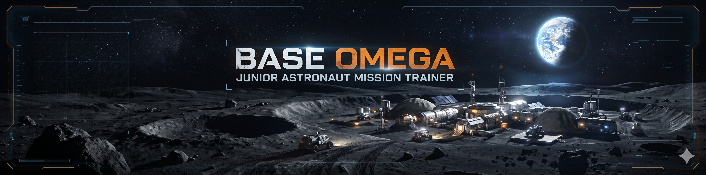

# 🚀 BASE OMEGA — Junior Astronaut Mission Trainer

**Plan wisely. Protect the crew. Complete the mission.**

Base OMEGA is an interactive Moon-outpost survival and strategy simulator developed for the **NASA Space Apps Challenge 2026 – Junior Astronaut Mission Trainer** challenge.

The project puts players in command of a lunar outpost for a simulated 10-day mission. They must manage essential resources, maintain crew well-being, operate life-support systems, and respond to environmental threats such as solar flares.

Every decision has consequences. A choice that benefits one system may put pressure on another.

🔗 **Live Demo:** https://Ansh2906-dev.github.io/BASE_OMEGA/

---

## 🌕 Project Overview

Space exploration requires careful resource management, planning, and decision-making. On the Moon, resources are limited, resupply takes time, and environmental hazards can threaten crew safety.

Base OMEGA transforms these challenges into an accessible, decision-based learning experience for young explorers aged 7–12.

Players take the role of a mission commander and make daily decisions to keep the crew alive and the outpost operational for all 10 days.

## 🎮 Key Features

- **10-Day Mission Simulation:** Experience a simulated lunar outpost mission through daily decisions.
- **Resource Management:** Monitor oxygen, water, food, power, equipment, funding, radiation, and crew happiness.
- **Strategic Decision-Making:** Balance food quotas, oxygen production, operating modes, and resupply orders.
- **Solar Flare Events:** Encounter space-weather events based on saved NASA DONKI sample records.
- **Shelter Mode:** Reduce radiation exposure while managing additional power consumption.
- **Delayed Resupply:** Plan ahead because supplies do not arrive instantly.
- **Interactive Learning:** Understand the consequences of decisions through short educational explanations.

## 🛰️ How It Works

The gameplay follows a simple mission cycle:

1. **Check the Base** – Review the current resource and crew status.
2. **Choose Your Plan** – Set food quotas, oxygen production, operating mode, and resupply.
3. **End the Day** – Resources are consumed and equipment operates.
4. **Respond to Events** – React to environmental events such as solar flares.
5. **Learn and Continue** – Understand the consequences and prepare for the next day.

**Mission Objective:** Keep the crew alive and the lunar outpost operational for all 10 days.

## ⚙️ Resource Management & Strategy

The simulator demonstrates how different outpost systems are interconnected.

| Resource / System | Role |
|---|---|
| Oxygen | Essential for crew survival |
| Water | Supports recycling and oxygen production |
| Food | Maintains crew well-being |
| Power | Operates essential equipment |
| Equipment | Supports life-support systems |
| Radiation | Represents environmental exposure |
| Happiness | Represents crew morale |
| Funding | Tracks available mission resources |

There is no single perfect strategy. Players must balance competing requirements throughout the mission.

## ☀️ NASA Data Integration

Base OMEGA incorporates a saved sample of solar-flare records attributed to NASA's **DONKI** (Space Weather Database Of Notifications, Knowledge, Information).

These records are used to introduce random solar-flare events into gameplay.

- Solar-flare events can increase the radiation meter.
- Stronger flare classes receive larger effects in the simplified game model.
- Shelter mode helps reduce radiation impact at the cost of additional power.
- Short educational explanations connect gameplay events with real space-weather concepts.

> **Data Note:** The current prototype uses saved sample data, not a live connection to NASA APIs. Game values and event effects are simplified for educational purposes.

## 🛠️ Technology Stack

- HTML5
- CSS3
- JavaScript (no frameworks, no build step)
- NASA DONKI sample data

## 📁 Project Structure

```
BASE_OMEGA/
├── index.html      # Page structure and dialogs
├── style.css       # Space-themed, responsive styling
├── script.js       # Game logic and DONKI sample data
├── README.md
├── LICENSE
└── assets/
    ├── icons/      # Favicon
    └── images/     # Reserved for future artwork
```

## ▶️ Run Locally

No installation is needed. Download or clone the repository and open `index.html` in any modern browser.

## 🎯 Educational Objectives

Base OMEGA aims to introduce young explorers to:

- Space science and lunar exploration.
- Life-support systems and resource recycling.
- Space weather and radiation awareness.
- Systems thinking and interconnected resources.
- Strategic planning and decision-making.
- Learning through experimentation and consequences.

## 🚧 Future Development

Planned improvements include:

- Fine-tuning resource consumption and game balancing.
- Verifying and documenting the selected NASA DONKI records.
- Improving usability through testing with the target age group.
- Expanding mission scenarios and environmental events.
- Further improving the interactive learning experience.

## 🌍 Project Information

- **Project:** Base OMEGA — Junior Astronaut Mission Trainer
- **Challenge:** NASA Space Apps Challenge 2026
- **Category:** Educational Simulation / Space Exploration
- **Target Audience:** Young Explorers (7–12 years)

## 📄 License

Released under the [MIT License](LICENSE).

---

### 🌌 Explore. Strategize. Survive.

*Every decision keeps a Moon crew alive.*


